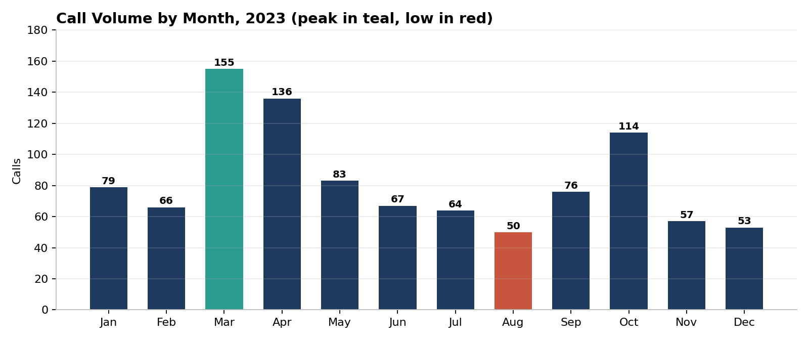
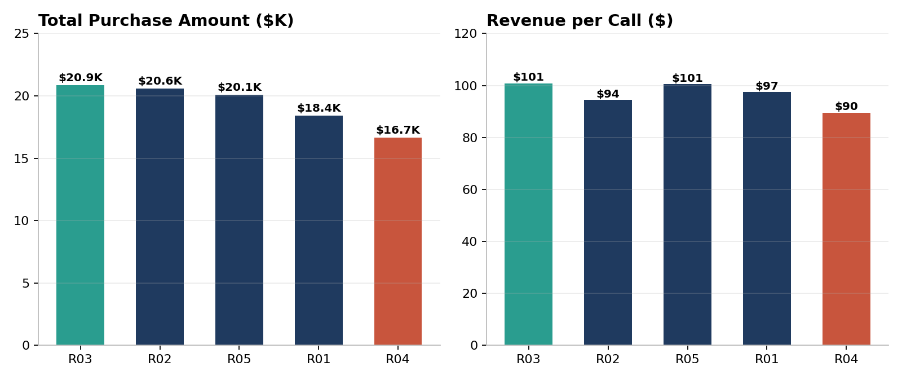
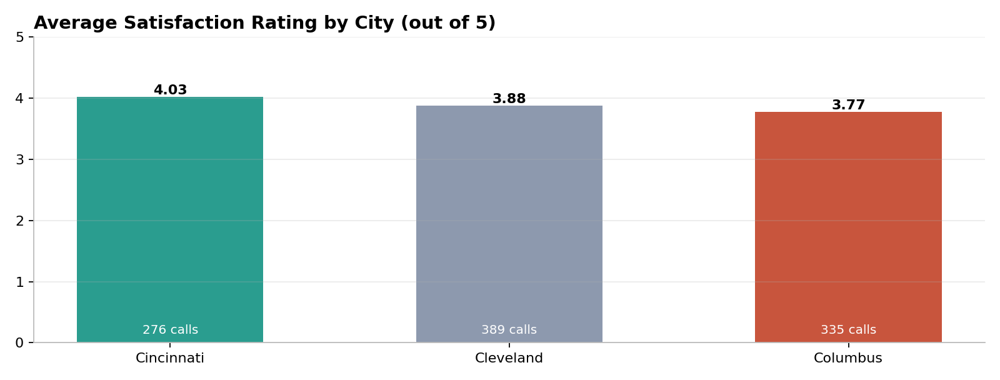

# Call Center Performance Analysis Dashboard

---

## Executive Summary

A customer call center needed one view of call volume, sales, representative performance and customer satisfaction. This project turns 1,000 call records into an interactive Excel dashboard that tracks revenue, call demand and service quality by representative, city and time period.

**Core Impact:** Surfaced a **3.1x seasonal swing in call volume** (155 calls in March vs 50 in August) and a **25% revenue gap between the top and bottom representatives** ($20.9K vs $16.7K), giving managers clear targets for staffing and coaching across **$96.6K** in total purchases.

---

## Dashboard Preview

| Representative Performance | Satisfaction by City |
|:---:|:---:|
|  |  |

The full interactive dashboard is in `Call_Center_Analysis_Project.xlsx` (Dashboard sheet), with a slicer to filter every view by representative.

---

## Business Question

How can the call center balance staffing, representative coaching and service quality to increase sales per call and customer satisfaction?

---

## Tech Stack

| Layer | Tools |
|:---|:---|
| Spreadsheet Platform | Microsoft Excel |
| Data Preparation | Excel Tables with structured references; calculated columns using `IF`, `MONTH`, `YEAR`, `TEXT`, `IFS` and `ROUND` |
| Data Modeling | Excel Data Model (relationship between the `calls` and `customers` tables) |
| Analysis | 9 PivotTables, rank and share-of-calls KPIs |
| Visualization | 7 charts, slicer, conditional formatting, dashboard layout |

---

## Data Pipeline and Methodology

| Step | Sheet | Focus |
|:---:|:---|:---|
| 1 | `Data` | Loaded call records and customer attributes into two Excel Tables (`calls`, `customers`) and added calculated columns: fiscal year (July to June), day of week, duration bucket and rounded rating |
| 2 | `Data` | Linked the two tables in the Data Model so calls could be analyzed by customer city and gender |
| 3 | `Pivots` | Built PivotTables for core KPIs (call count, total amount, total duration, average rating, 5-star calls), monthly and weekday call volume, representative performance, city and gender mix, and rating distribution |
| 4 | `Dashboard` | Combined KPI cards, charts and a representative slicer into one interactive view |

**Dataset Note:** 1,000 call records from 5 representatives and 15 customers across 3 cities (Cincinnati, Cleveland, Columbus), covering 1 January to 31 December 2023. Fields: call number, customer ID, duration, representative, date, purchase amount and satisfaction rating.

---

## Key Findings

| # | Finding | Evidence |
|:---:|:---|:---|
| 1 | **Call demand is highly seasonal** | March peaks at **155 calls** versus **50 in August** (3.1x). October is a second peak at 114 calls, and March alone is 15.5% of annual volume. |
| 2 | **Representative revenue varies widely** | R03 leads with **$20.9K** and $100.83 per call; R04 trails with **$16.7K** and $89.52 per call. R04 also has the longest average call (95.7 min vs 85.5 min for R03). |
| 3 | **Satisfaction differs by city** | Cincinnati averages **4.03 out of 5** versus **3.77** in Columbus, even though call length is nearly identical (about 90 minutes in each city). |
| 4 | **Cleveland drives the most activity** | **389 calls (38.9%)** and **$37.8K** in purchases, the largest share of any city. |
| 5 | **Longer calls do not mean bigger sales** | Call duration has almost no relationship with purchase amount (correlation -0.01) or satisfaction (0.01). Calls of 30 to 60 minutes average **$103.83** versus **$94.05** for calls over 2 hours. |
| 6 | **Service quality is solid overall** | Average rating is **3.89 out of 5**, with **30.7%** of calls rated 4.5 or higher. |

---

## Strategic Recommendations

| Priority | Recommendation | Rationale |
|:---:|:---|:---|
| 1 | **Staff to the seasonal curve** | Add capacity in March and October and schedule leave or training in August, when volume is lowest. |
| 2 | **Coach on call efficiency** | Share R03 and R05 call practices with R04, who spends the most time per call but earns the least per call. |
| 3 | **Review the Columbus experience** | Investigate why satisfaction trails Cincinnati by 0.26 points despite similar call lengths. |
| 4 | **Stop using call length as a quality signal** | Duration shows no link to sales or satisfaction. Track revenue per call and rating instead. |
| 5 | **Test a 30 to 60 minute target** | These calls show the highest average purchase. Validate with a controlled pilot before setting it as policy. |

---

## Notes and Limitations

- **Sample dataset:** the data is a portfolio-scale sample with only 15 customers, so city and gender comparisons reflect a small customer base.
- **Call duration** is assumed to be in minutes, based on the duration buckets used in the workbook.
- **Fiscal year** is defined as July to June, so calls from July to December 2023 fall into FY2024.
- **Correlation is not causation:** the duration findings describe association only.

---

## Repository Structure

| Path | Description |
|:---|:---|
| `Call_Center_Analysis_Project.xlsx` | Workbook with source data, PivotTables, Data Model and the interactive dashboard. |
| `assets/` | Preview charts used in this README. |
| `README.md` | Project documentation and executive summary. |
